# StreamChrome Server

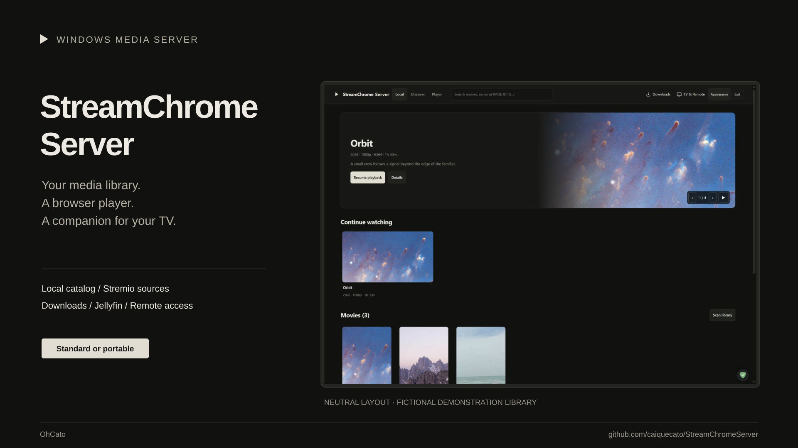

A Windows media server with a browser player, local movie and series catalog, Stremio addon sources, downloads, and a Jellyfin companion for TVs. Built with Python, FFmpeg, and vanilla HTML, CSS, and JavaScript.

[Download the Windows installer](https://github.com/caiquecato/StreamChromeServer/releases/latest) · [Build documentation](docs/BUILD.md) · [Component notices](docs/THIRD_PARTY_LICENSES.md)

## Install

Open the latest release and download `StreamChromeServer-<version>-Setup.exe`. Windows x64 and an internet connection are required. Python does not need to be installed separately.

The public installer downloads pinned components over HTTPS and checks their SHA-256 hashes before installation: FFmpeg/FFprobe, Jellyfin, yt-dlp, Deno, and cloudflared. Their URLs and expected hashes are recorded in [installer/dependencies.json](installer/dependencies.json). FFmpeg is obtained from Gyan's Windows builds; the other components come from their upstream release repositories.

Choose an installation mode in the wizard:

| Mode | Application and data |
| --- | --- |
| Standard | Installs under `%LOCALAPPDATA%\Programs\StreamChromeServer`, with a Start menu shortcut and uninstaller. Settings and runtime data use `%LOCALAPPDATA%\StreamChromeServer`; the default media library is `%USERPROFILE%\Videos\StreamChromeServer`. |
| Portable | Installs into a folder you choose on an HD or USB drive. Engines and data stay in `app/`, with `Movies/` and `Series/` beside the executable. No shortcuts or uninstall registration are created. Portable auto-launch is an optional, unchecked installation task. Internet access is still required during installation. |

The public release uses this online installer for both modes. Close the application before updating it, then keep the same mode and destination. Standard uninstallation preserves profile data and the media library.

## Start watching

1. Launch **StreamChrome Server** and open the hub at [localhost:8780](http://localhost:8780).
2. Add your media under the library's `Movies/` or `Series/` folders, then select **Scan library** in **Local**.
3. Open a title to play it or inspect its details. For a series, open **Episodes** and choose an episode.
4. Use **Discover** to browse catalogs or search by title or IMDb ID. Open **Settings > Sources and subtitles > Manage addons** to add an HTTPS Stremio `manifest.json` URL.

Example library structure:

```text
Movies/
  Movie Title (2026)/
    Movie Title (2026).mkv
Series/
  Show Title (2026)/
    Season 01/
      Show Title S01E01.mkv
```

The interface supports English, Portuguese, and Spanish. Open **Settings > Appearance** to change the language, light/dark theme, or layout. Existing `Filmes/` folders remain part of catalog scans; they are not renamed or moved. New movie downloads use `Movies/`.

## Six browsing layouts

Each layout changes the catalog composition as well as its colors. Figure 1 is the cover above; Figures 2–7 show the six browsing layouts below.

| Neutral | Cinema |
| --- | --- |
| A portrait gallery and split feature. | A larger feature and landscape browsing shelves. |
| 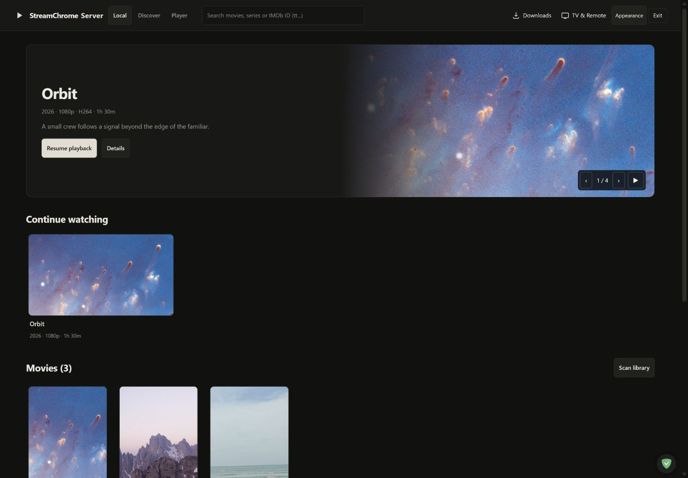 | 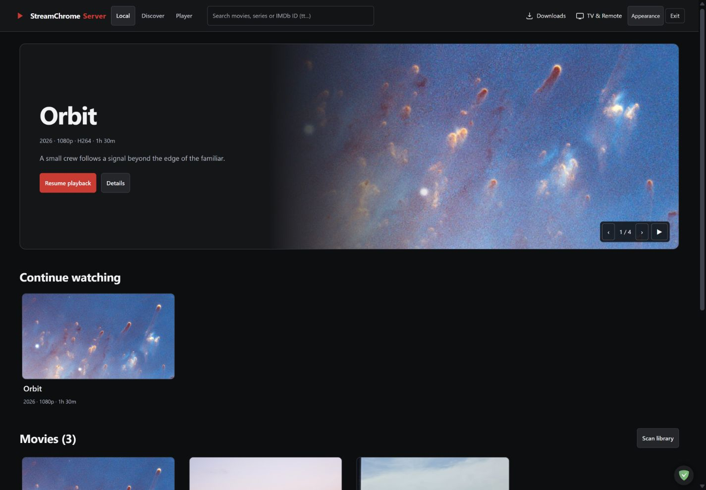 |

| Classic | Studio |
| --- | --- |
| Compact horizontal cards with metadata beside each thumbnail. | A broad artwork panel and a four-column browsing board. |
| 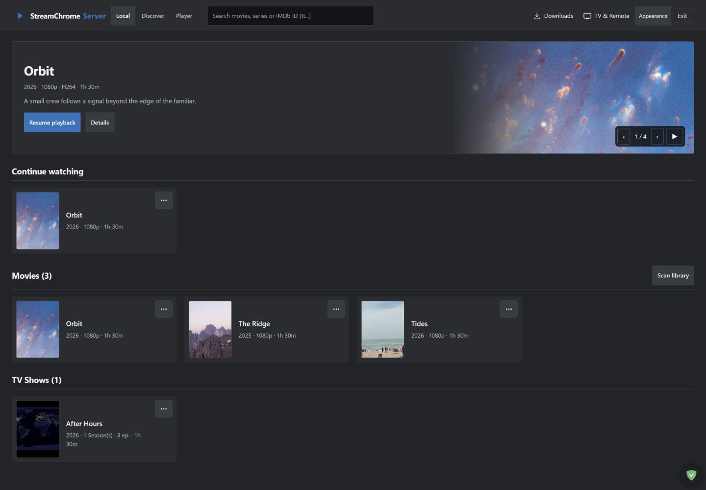 | 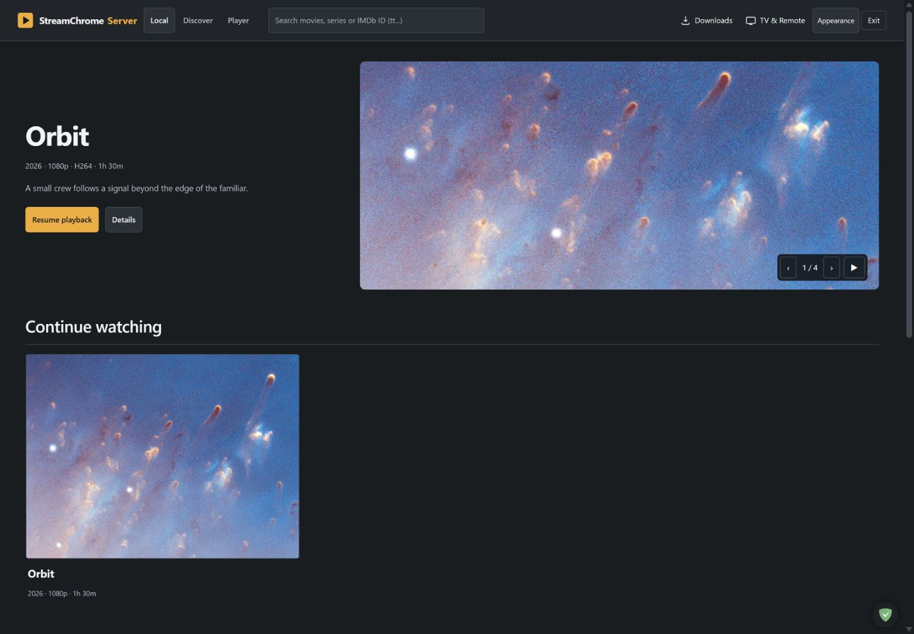 |

| Library | Quiet Glass |
| --- | --- |
| One row per title, with a separate metadata column. | A centered collection with larger portrait artwork and rounded controls. |
| 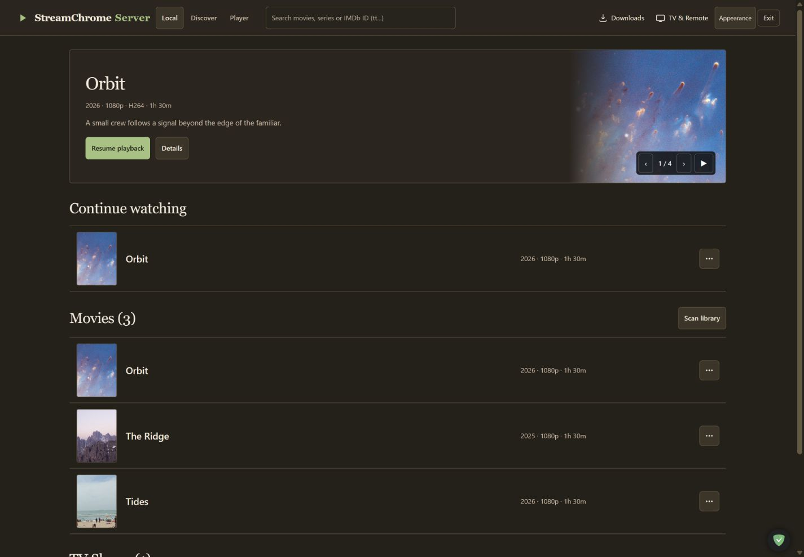 | 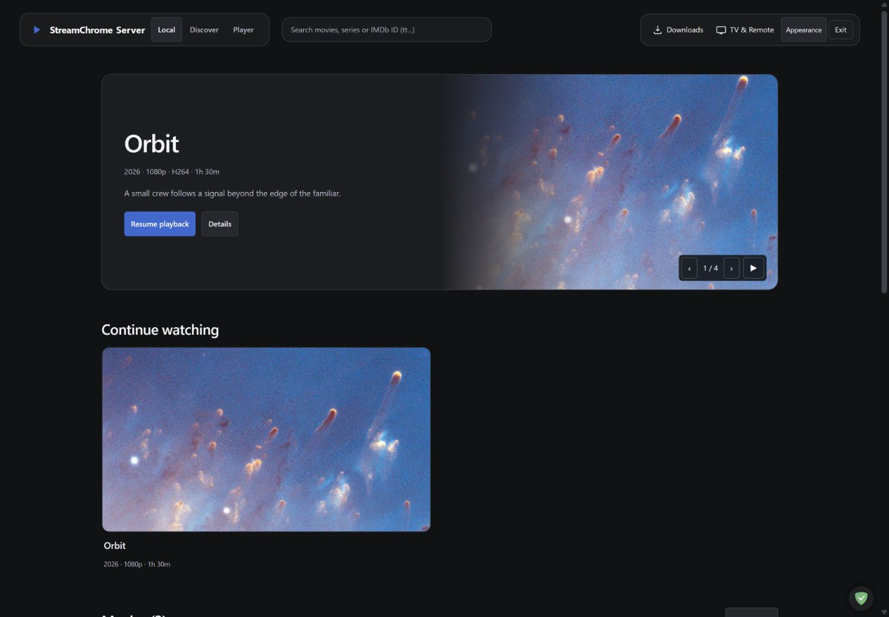 |

The featured title carousel has previous, next, and pause controls. Watch progress appears on catalog cards, and **Continue watching** returns to unfinished titles.

## Discover and episode sources

Discover has three selectors: **Type**, **Catalog**, and **Genre**. Catalogs and their filters are read from Cinemeta and configured addon manifests. A year-based catalog labels its third selector **Year**. Provider-specific catalogs appear only when an installed addon actually declares them; configuring a stream addon alone does not create a provider catalog.

Figure 17 shows the current selectors. Figure 8 records the genre-filtered series view from version 1.0.0.

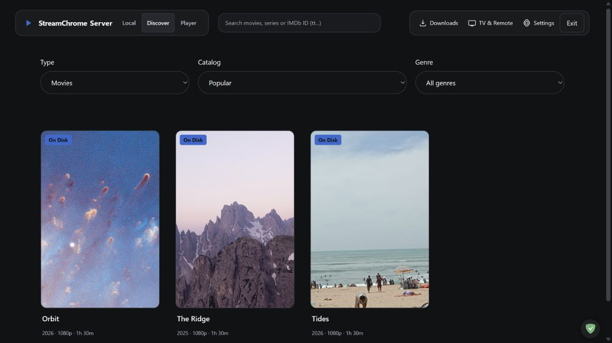

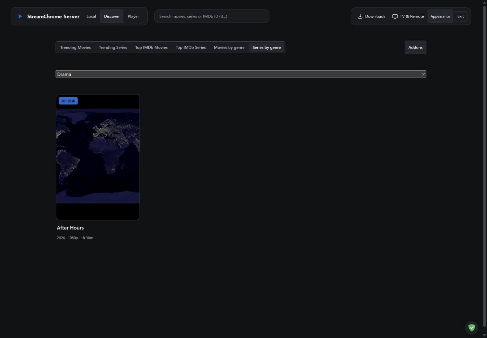

Open an episode to inspect its available addon sources in a separate overlay. Filter by available quality or language tags, then choose **Watch now** or **Download to library**. Figure 9 shows this source overlay; available playback and download actions depend on the source returned by the addon.

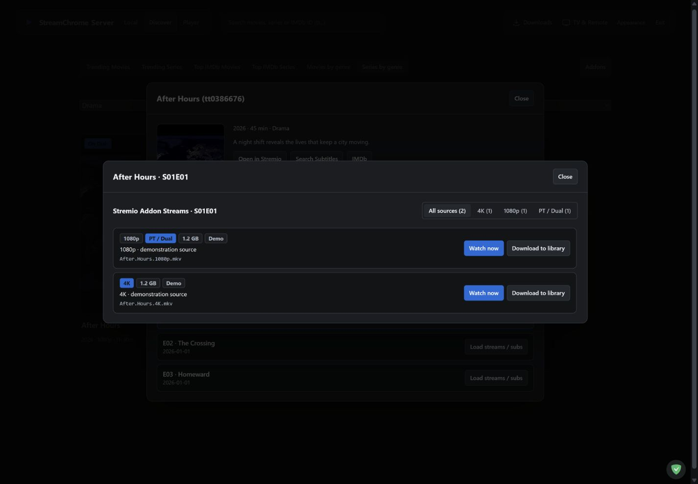

**Download season** lets you select episodes and choose a source for each before submitting the download queue. Figure 10 shows two selected episodes and one excluded episode.

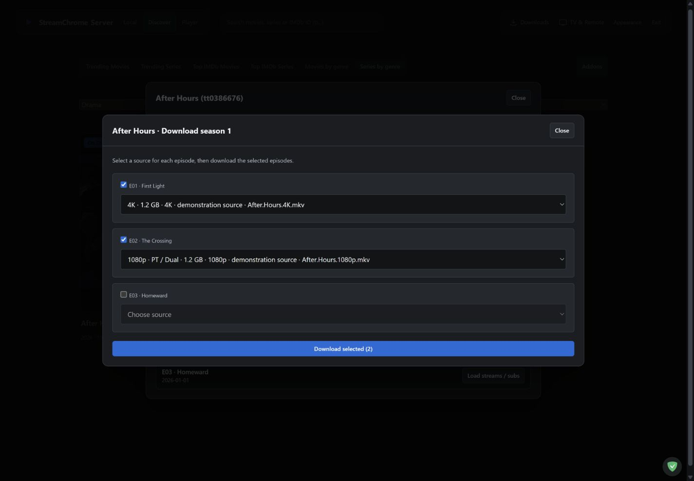

The catalog adapts to narrow screens. Figure 11 shows a series feature with its playback, episode, detail, and carousel controls.

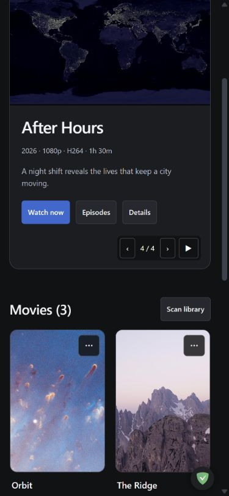

## Playback and downloads

The browser player supports FFmpeg remuxing or transcoding, audio track selection, and subtitles from local files, SubDL, OpenSubtitles, and addons. NVIDIA NVENC is used when available; codec and hardware support determine which playback modes can be used.

An active floating miniplayer keeps the video visible while you browse **Local** or **Discover**. Figure 12 shows a local video playing above the catalog.

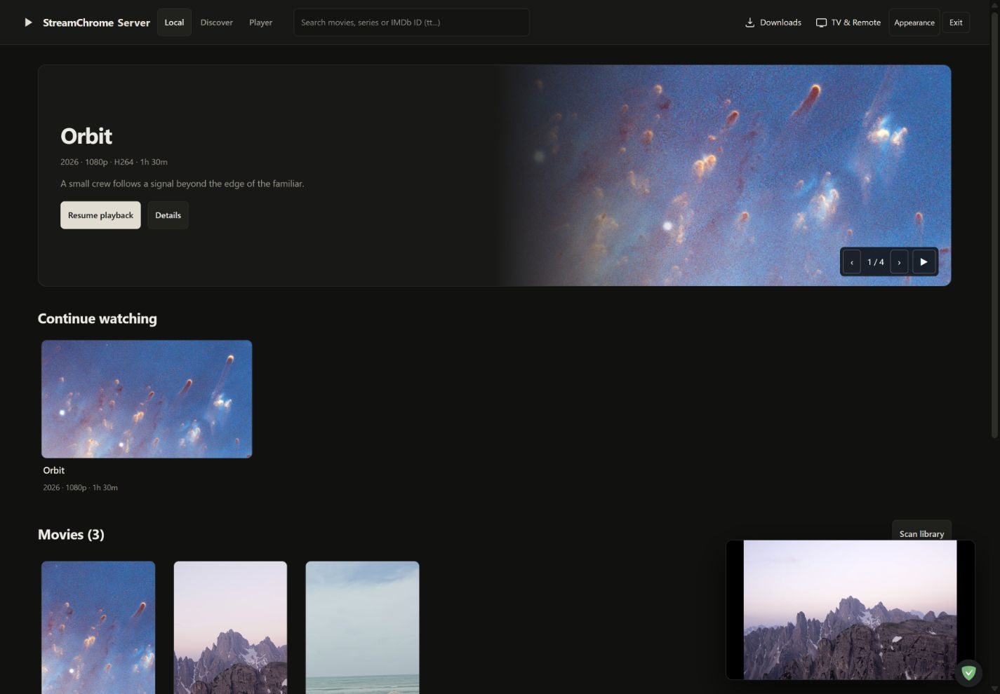

Title details include FFprobe-derived resolution, bitrate, duration, codec/profile, frame rate, audio tracks, and file size when available. Figure 13 shows specifications read from the demonstration video file.

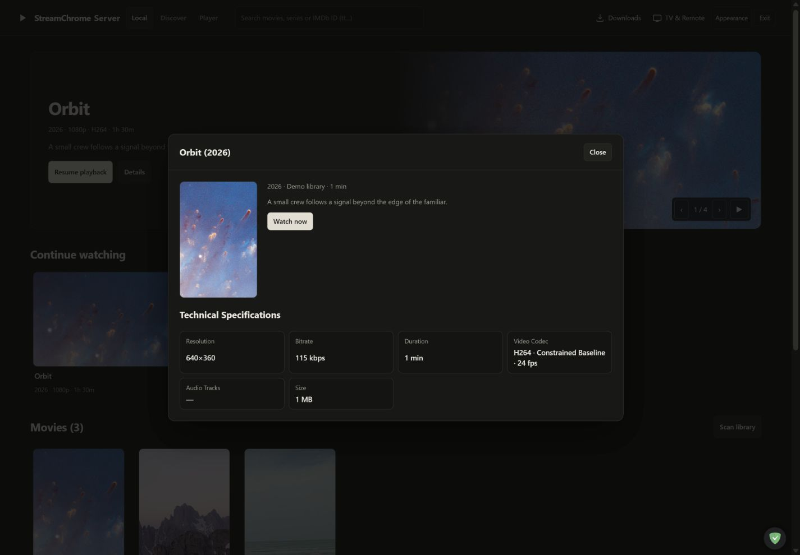

The download queue supports direct HTTPS sources and yt-dlp links. Direct downloads can resume partial files through HTTP Range requests when the source supports them. Completed library downloads are organized into title folders and trigger local and Jellyfin scans.

## TV and remote access

Open **TV & Remote** for LAN addresses, QR codes, the M3U playlist, and Jellyfin access. The hub uses port `8780`; Jellyfin uses port `8096`. A Windows Firewall helper is available for private-network access.

Optional Cloudflare Tunnel access provides an HTTPS address with a server PIN. Use the system tray controls or the hub's **Exit** button to stop the server and Jellyfin. The themed Exit dialog asks for confirmation before stopping playback and active downloads (Figure 16).

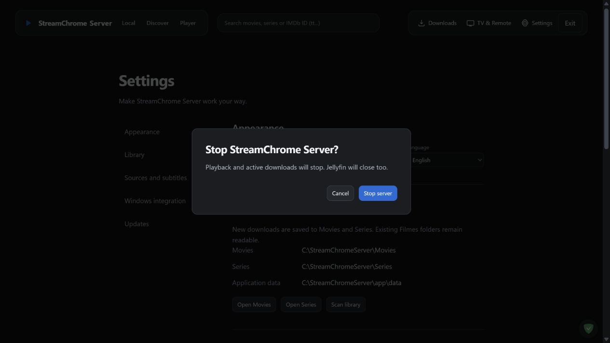

## Settings, Windows integration, and updates

**Settings** brings appearance, library paths and scanning, subtitle credentials, addon management, Windows integration, and updates into one page. Figure 14 shows its appearance and library sections; Figure 15 shows the themed addon form.

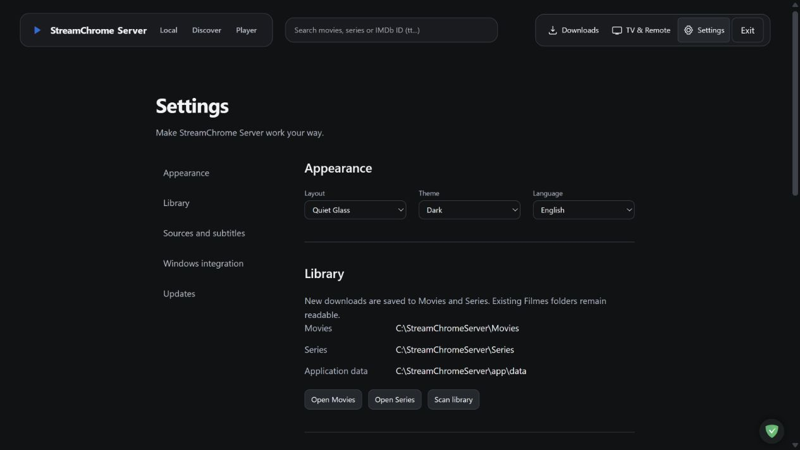

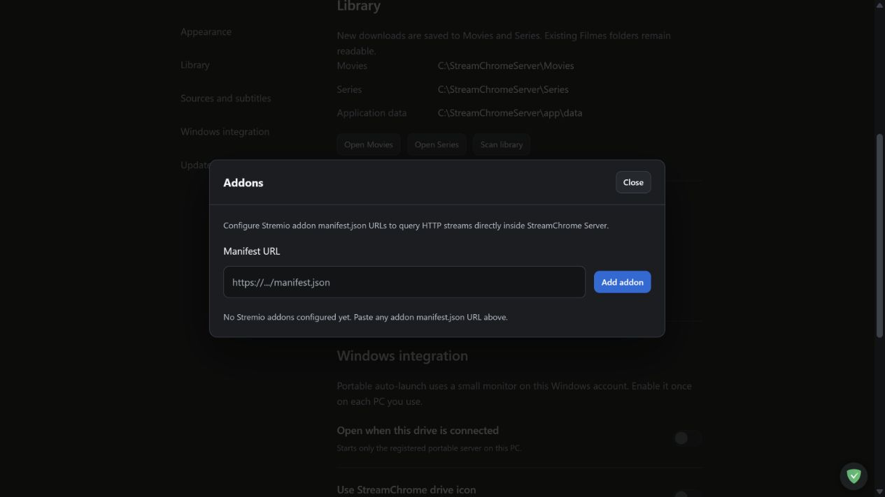

Portable installations offer two separate options, both off by default:

- **Open when this drive is connected** installs a local watcher for this PC and Windows account. It adds that watcher to the current user's Windows startup entry and launches only the registered portable executable when its drive is detected. Enable it on each PC where you want this behavior, either in the installer or in **Settings > Windows integration**. It does not make Windows run an arbitrary USB executable automatically on other computers.
- **Use StreamChrome drive icon** changes only the drive icon entry in its root `autorun.inf`. Existing unrelated entries are preserved; an existing icon or unsupported file encoding is left intact with an error. No drive is formatted. Disable the option to restore the prior file, provided it has not since been edited elsewhere.

Version 1.0.0 has no built-in updater. To move from 1.0.0 to 1.1.0, run the new installer once using the same mode and destination. Later application updates can be installed from **Settings > Updates** in the packaged desktop application.

The updater checks the latest stable release in this GitHub repository, downloads `StreamChromeServer-<version>-app.zip`, and verifies its SHA-256 against GitHub's release asset digest. It accepts only a package containing `StreamChromeServer.exe`, then stops and restarts the server to replace that executable. Engines, media, settings, and catalog data are outside the update package. The app ZIP is for updating an existing installation; use the setup executable for a full installation.

### Credentials

Subtitle API keys, addon configuration that may include private tokens, and Jellyfin link credentials are encrypted for the current Windows user with DPAPI. Remote access stores a salted PIN hash. Browser-facing addon information uses masked URLs and session tokens.

Keep media, runtime data, and credentials out of version control. The repository's ignore rules exclude application data and local build outputs.

## Development

The application runs from `src/server_pro.py`. Source checkouts use the project root for media and data; engine folders follow the paths resolved in that file. See [BUILD.md](docs/BUILD.md) for packaging and [THIRD_PARTY_LICENSES.md](docs/THIRD_PARTY_LICENSES.md) for component notices and provenance.

```powershell
python src/server_pro.py --local-only
```

Run the Python and JavaScript checks from the repository root:

```powershell
python -m unittest discover -s tests -v
Get-ChildItem tests/*.cjs | ForEach-Object { node $_.FullName }
```

To build the public online installer, install the build requirements and Inno Setup 6.7 or later, then run:

```powershell
python -m pip install -r requirements-build.txt
python scripts/build_online_installer.py
```

The builder requires a new output directory and refuses to overwrite an existing one. Dependency versions and SHA-256 pins are maintained in `installer/dependencies.json`.

## Screenshots and credits

Figures 2–13 were captured with version 1.0.0. Figures 14–17 show the Settings, addon, Exit, and discovery interfaces introduced in 1.1.0.

Orbit, The Ridge, Tides, and After Hours are fictional demonstration titles. Their artwork is licensed photography, not official movie posters. The small demonstration video and its metadata illustrate playback and file inspection; screenshots do not represent a supplied media collection.

See [visual_credits.md](docs/visual_credits.md) for image authors, licenses, and source pages. Application by **OhCato**. [Support the project](https://buymeacoffee.com/caique1704u).
